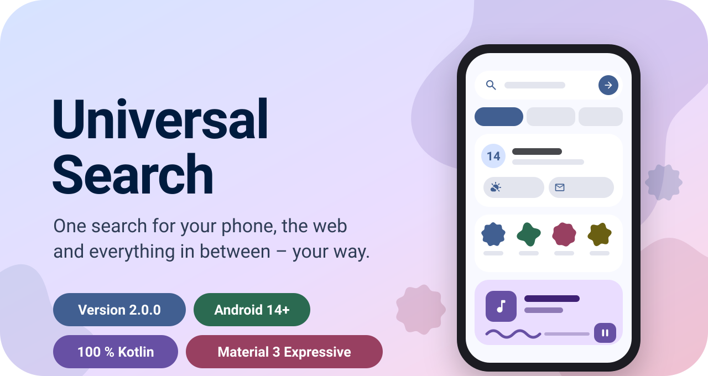
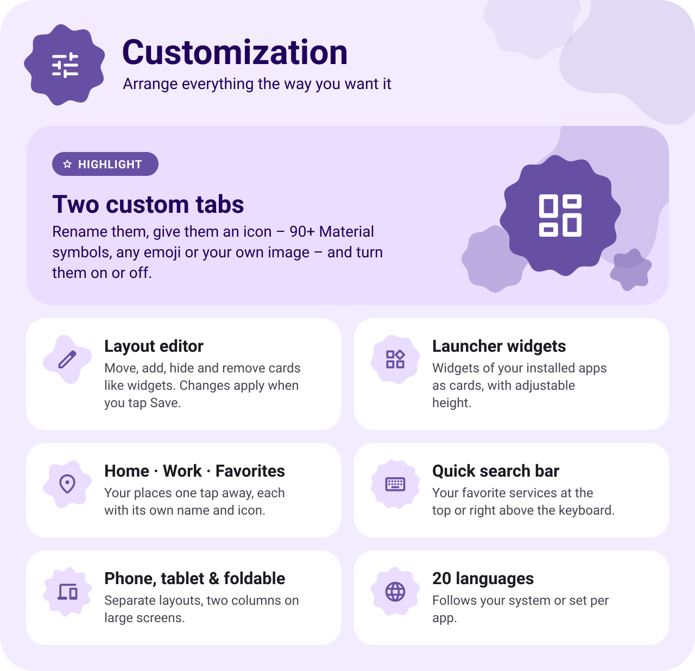
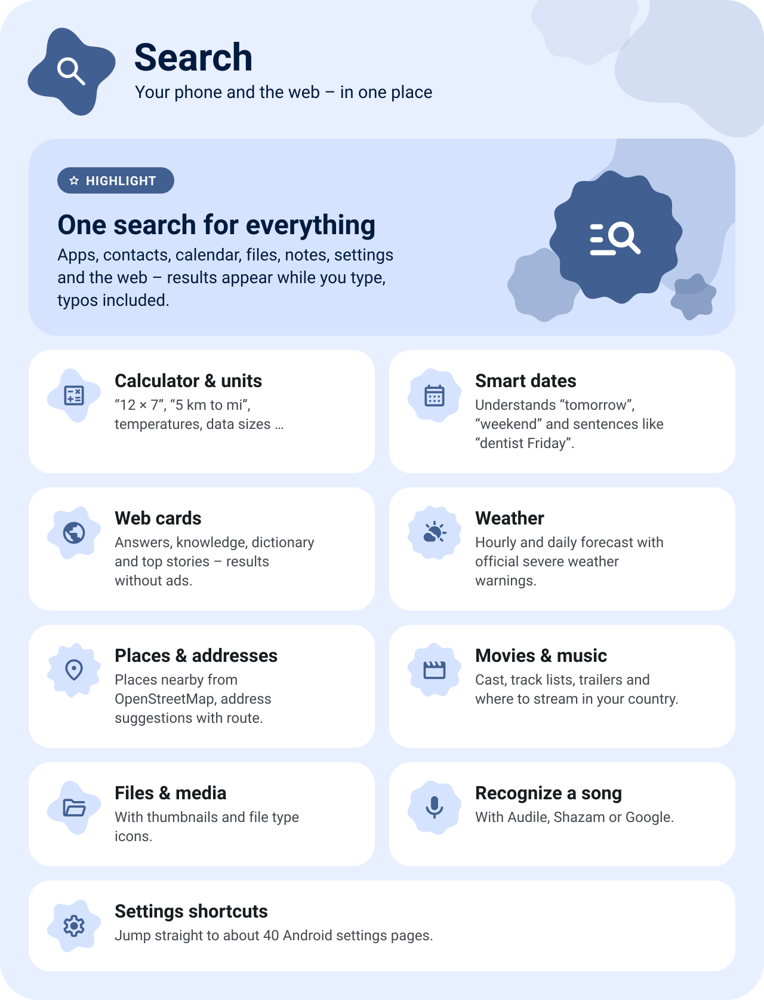
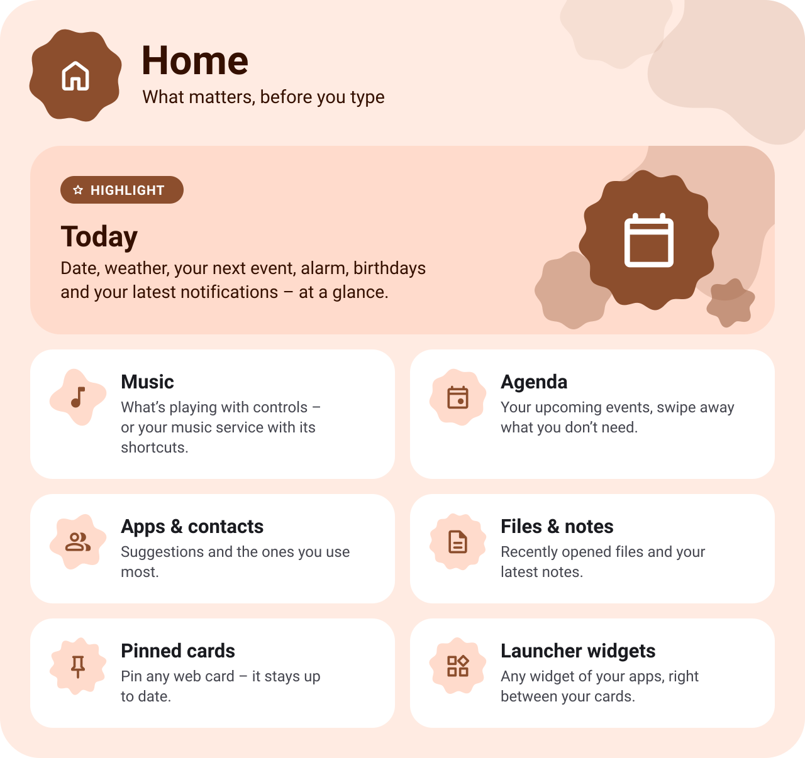
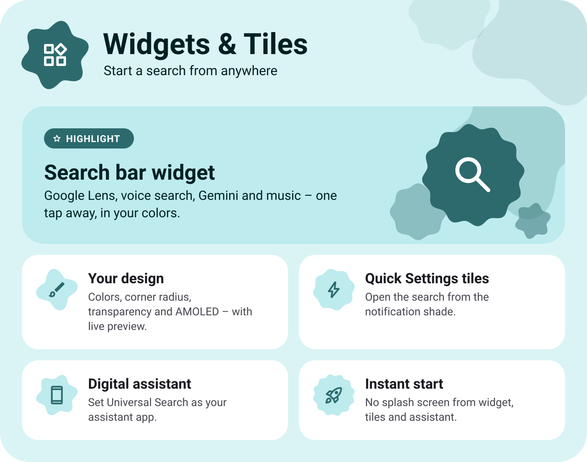
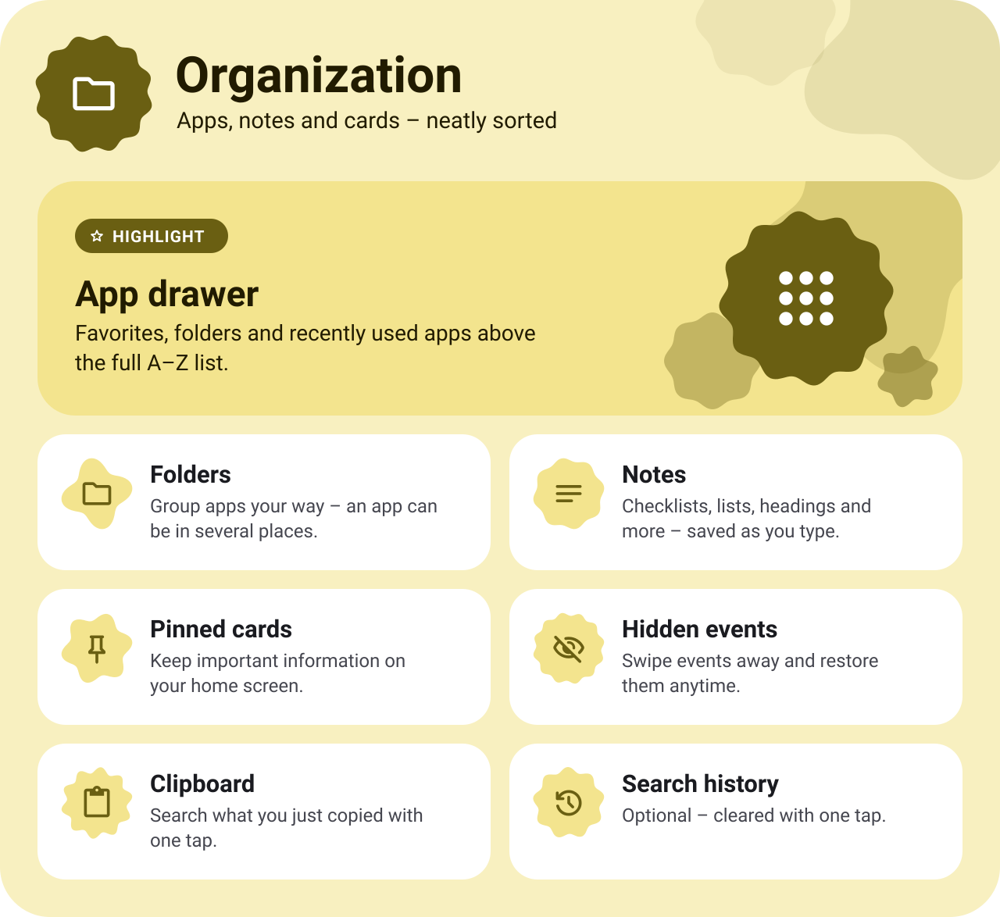
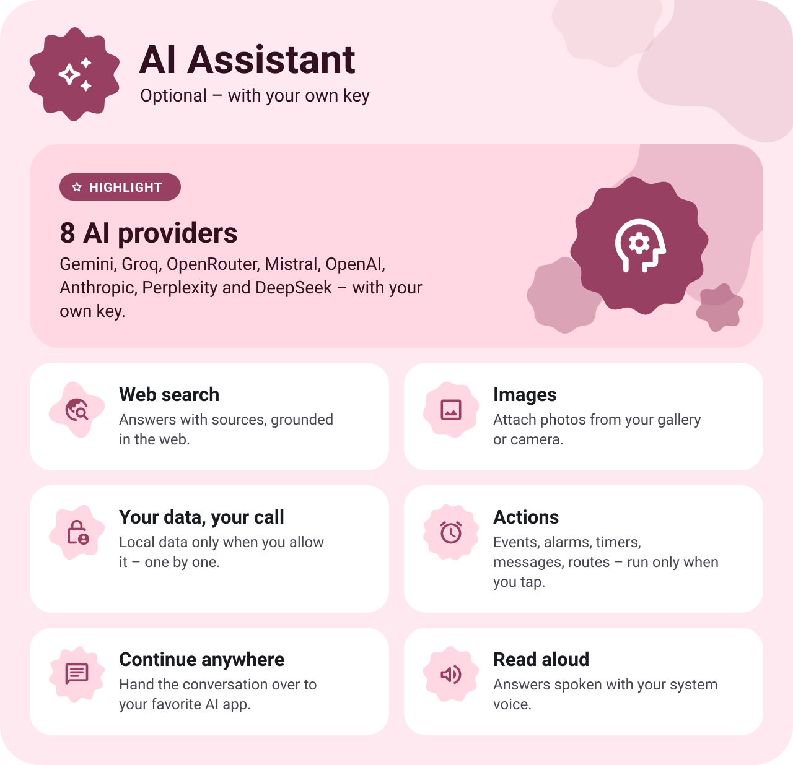
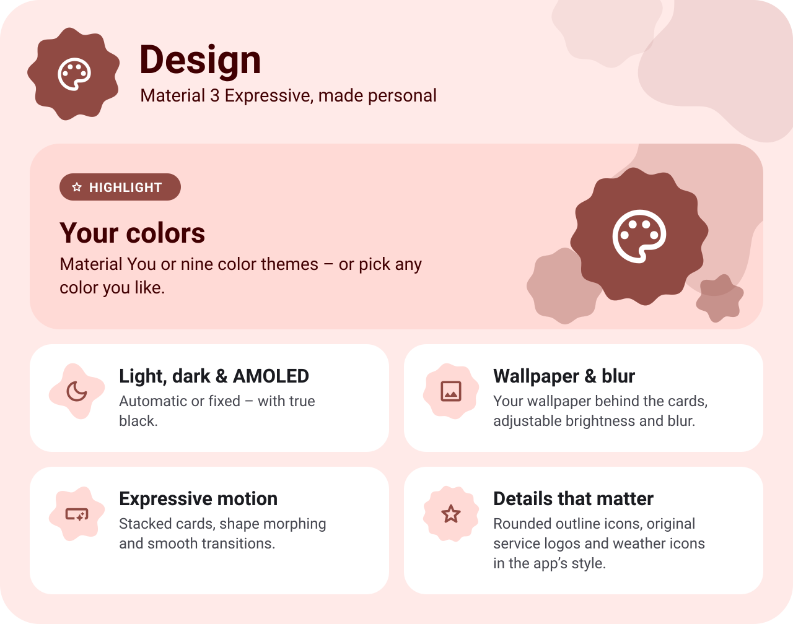
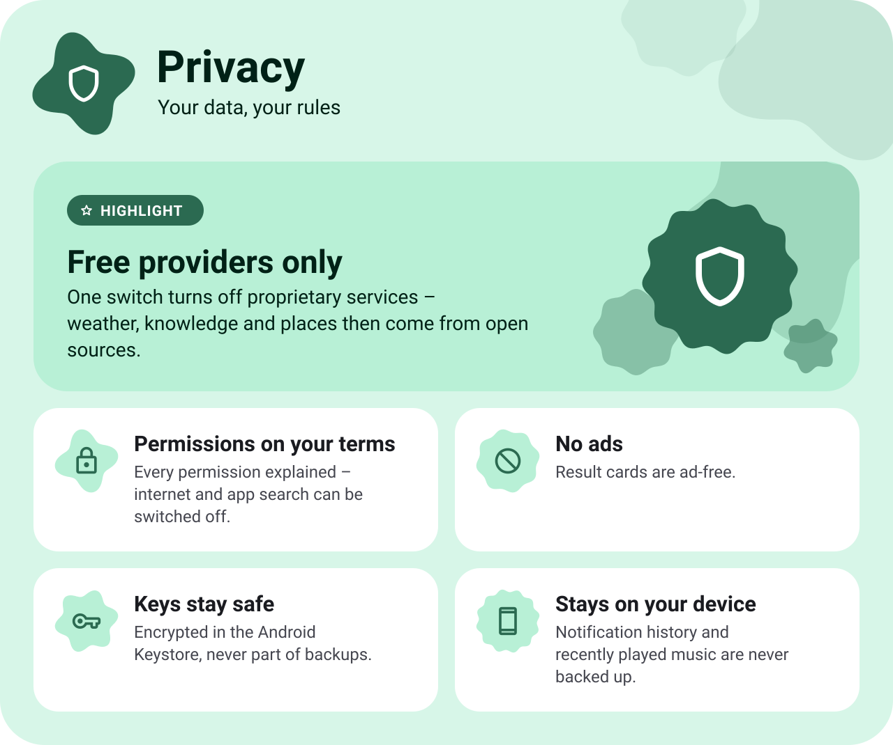
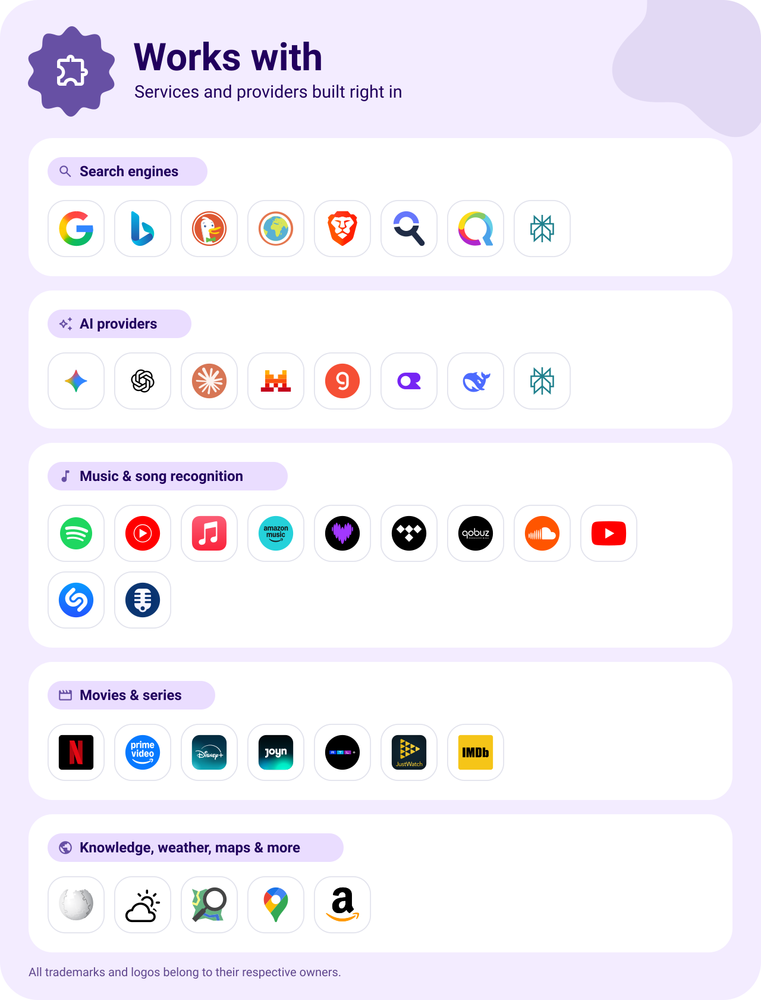

<div align="center">

<picture>
  <source media="(prefers-color-scheme: dark)" srcset="readme/panels/dark/hero.svg">
  
</picture>

<p><br></p>

<a href="#customization"><b>Customization</b></a> &nbsp;·&nbsp; <a href="#search"><b>Search</b></a> &nbsp;·&nbsp; <a href="#home"><b>Home</b></a> &nbsp;·&nbsp; <a href="#widgets"><b>Widgets &amp; Tiles</b></a> &nbsp;·&nbsp; <a href="#organization"><b>Organization</b></a> &nbsp;·&nbsp; <a href="#ai"><b>AI Assistant</b></a> &nbsp;·&nbsp; <a href="#design"><b>Design</b></a> &nbsp;·&nbsp; <a href="#privacy"><b>Privacy</b></a> &nbsp;·&nbsp; <a href="#works-with"><b>Works with</b></a> &nbsp;·&nbsp; <a href="#get-started"><b>Get started</b></a>

</div>

<br>

<a name="customization"></a>

<picture>
  <source media="(prefers-color-scheme: dark)" srcset="readme/panels/dark/customization.svg">
  
</picture>

<!-- Screenshots / videos: put files into readme/media/customization/ and remove the comment.
<p align="center">
  &nbsp;
  &nbsp;
  
</p>
-->

<br>

<a name="search"></a>

<picture>
  <source media="(prefers-color-scheme: dark)" srcset="readme/panels/dark/search.svg">
  
</picture>

<!-- Screenshots / videos: put files into readme/media/search/ and remove the comment.
<p align="center">
  &nbsp;
  &nbsp;
  
</p>
-->

<br>

<a name="home"></a>

<picture>
  <source media="(prefers-color-scheme: dark)" srcset="readme/panels/dark/home.svg">
  
</picture>

<!-- Screenshots / videos: put files into readme/media/home/ and remove the comment.
<p align="center">
  &nbsp;
  &nbsp;
  
</p>
-->

<br>

<a name="widgets"></a>

<picture>
  <source media="(prefers-color-scheme: dark)" srcset="readme/panels/dark/widgets.svg">
  
</picture>

<!-- Screenshots / videos: put files into readme/media/widgets/ and remove the comment.
<p align="center">
  &nbsp;
  
</p>
-->

<br>

<a name="organization"></a>

<picture>
  <source media="(prefers-color-scheme: dark)" srcset="readme/panels/dark/organization.svg">
  
</picture>

<!-- Screenshots / videos: put files into readme/media/organization/ and remove the comment.
<p align="center">
  &nbsp;
  
</p>
-->

<br>

<a name="ai"></a>

<picture>
  <source media="(prefers-color-scheme: dark)" srcset="readme/panels/dark/ai.svg">
  
</picture>

<!-- Screenshots / videos: put files into readme/media/ai/ and remove the comment.
<p align="center">
  
</p>
-->

<br>

<a name="design"></a>

<picture>
  <source media="(prefers-color-scheme: dark)" srcset="readme/panels/dark/design.svg">
  
</picture>

<!-- Screenshots / videos: put files into readme/media/design/ and remove the comment.
<p align="center">
  &nbsp;
  &nbsp;
  
</p>
-->

<br>

<a name="privacy"></a>

<picture>
  <source media="(prefers-color-scheme: dark)" srcset="readme/panels/dark/privacy.svg">
  
</picture>

<br>

<a name="works-with"></a>

<picture>
  <source media="(prefers-color-scheme: dark)" srcset="readme/panels/dark/works-with.svg">
  
</picture>

<br>

<a name="get-started"></a>

<a href="https://github.com/infowagnerdomenik-jpg/Universal-Search-for-Android/releases/latest">
<picture>
  <source media="(prefers-color-scheme: dark)" srcset="readme/panels/dark/get-started.svg">
  
</picture>
</a>

<!-- Build from source:
```
./gradlew :app:assembleRelease
```
-->

<br>

<div align="center">

<sub>Licensed under the <a href="license.txt">Apache License 2.0</a> · The font <i>Google Sans Flex</i> is licensed under the SIL Open Font License.</sub><br>
<sub>All trademarks and logos belong to their respective owners.</sub>

</div>
