<div align="center">
  
  <br><br>
  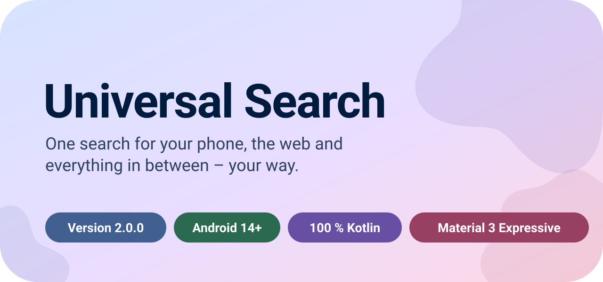
</div>

<!-- MEDIA · Hero video or screenshot (e.g. readme/hero/hero.png). Uncomment:
<p align="center"></p>
-->

<p align="center">
  <a href="#customization">Customization</a> ·
  <a href="#search">Search</a> ·
  <a href="#home">Home</a> ·
  <a href="#widgets">Widgets</a> ·
  <a href="#organization">Organization</a> ·
  <a href="#ai">AI</a> ·
  <a href="#design">Design</a> ·
  <a href="#privacy">Privacy</a> ·
  <a href="#works-with">Works with</a> ·
  <a href="#get-started">Get started</a>
</p>

<br>

<a name="customization"></a>

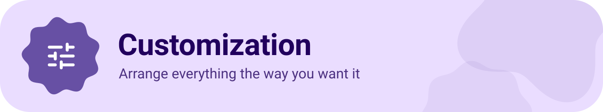

<table>
<tr>
<td width="50%"><b>Two custom tabs</b><br>Rename them, give them an icon and turn them on or off.</td>
<td width="50%"><b>Layout editor</b><br>Move, add, hide and remove cards like widgets – applied when you tap <i>Save</i>.</td>
</tr>
<tr>
<td>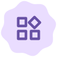<b>Launcher widgets</b><br>Widgets of your installed apps as cards, with adjustable height.</td>
<td><b>Your own icons</b><br>90+ Material symbols, any emoji or your own image – even as a single-color icon.</td>
</tr>
<tr>
<td><b>Home · Work · Favorites</b><br>Your places one tap away, each with its own name and icon.</td>
<td><b>Quick search bar</b><br>Your favorite services at the top or right above the keyboard.</td>
</tr>
<tr>
<td><b>Phone, tablet &amp; foldable</b><br>Separate layouts, two columns on large screens.</td>
<td><b>20 languages</b><br>Follows your system or set per app.</td>
</tr>
</table>

<!-- MEDIA · Customization. Uncomment and add your files:
<p align="center">
  &nbsp;
  &nbsp;
  
</p>
-->

<br>

<a name="search"></a>

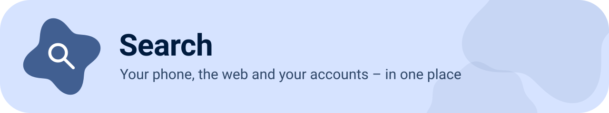

<table>
<tr>
<td width="50%"><b>Apps</b><br>Typo-tolerant, including app shortcuts.</td>
<td width="50%"><b>Contacts</b><br>By name, email or phone number.</td>
</tr>
<tr>
<td><b>Calendar</b><br>Understands <i>tomorrow</i>, <i>weekend</i>, dates and sentences like <i>"dentist Friday"</i>.</td>
<td><b>Files &amp; media</b><br>With thumbnails and file type icons.</td>
</tr>
<tr>
<td><b>Calculator &amp; units</b><br><i>"12 × 7"</i>, <i>"5 km to mi"</i>, temperatures, data sizes …</td>
<td><b>Settings shortcuts</b><br>Jump straight to about 40 Android settings pages.</td>
</tr>
<tr>
<td><b>Web cards</b><br>Answers, knowledge, dictionary and top stories – results without ads.</td>
<td><b>Weather</b><br>Hourly and daily forecast, including official severe weather warnings.</td>
</tr>
<tr>
<td><b>Places nearby</b><br>From OpenStreetMap – free, no key, no limit.</td>
<td><b>Address search</b><br>Suggestions with distance, route in one tap.</td>
</tr>
<tr>
<td><b>Movies &amp; music</b><br>Cast, track lists, trailers and where to stream in your country.</td>
<td><b>Recognize a song</b><br>With Audile, Shazam or Google.</td>
</tr>
<tr>
<td colspan="2"><b>Notes</b><br>Search your notes or save a new one right from the search bar.</td>
</tr>
</table>

<!-- MEDIA · Search. Uncomment and add your files:
<p align="center">
  &nbsp;
  &nbsp;
  
</p>
-->

<br>

<a name="home"></a>

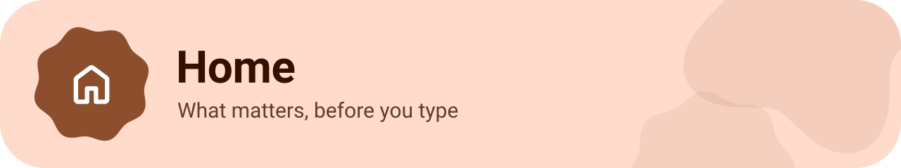

<table>
<tr>
<td width="50%"><b>Today</b><br>Date, weather, your next event, alarm, birthdays and your latest notifications.</td>
<td width="50%"><b>Music</b><br>What's playing with controls – or your music service with its shortcuts.</td>
</tr>
<tr>
<td><b>Agenda</b><br>Your upcoming events at a glance.</td>
<td><b>Apps &amp; contacts</b><br>Suggestions and the ones you use most.</td>
</tr>
<tr>
<td><b>Files &amp; notes</b><br>Recently opened files and your latest notes.</td>
<td><b>Pinned cards</b><br>Pin any web card – it stays up to date.</td>
</tr>
<tr>
<td colspan="2">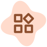<b>Launcher widgets</b><br>Any widget of your apps, right between your cards.</td>
</tr>
</table>

<!-- MEDIA · Home. Uncomment and add your files:
<p align="center">
  &nbsp;
  &nbsp;
  
</p>
-->

<br>

<a name="widgets"></a>

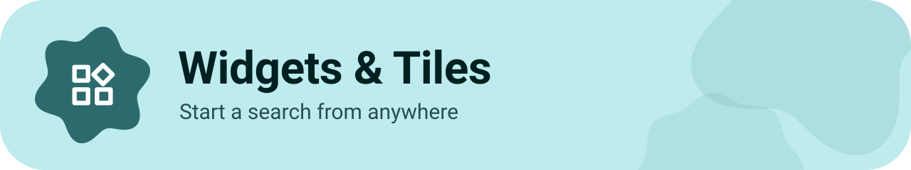

<table>
<tr>
<td width="50%"><b>Search bar widget</b><br>Google Lens, voice search, Gemini and music – one tap away.</td>
<td width="50%"><b>Your design</b><br>Colors, corner radius, transparency and AMOLED – with live preview.</td>
</tr>
<tr>
<td><b>Quick Settings tiles</b><br>Open the search from the notification shade.</td>
<td>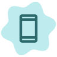<b>Digital assistant</b><br>Set Universal Search as your assistant app.</td>
</tr>
</table>

<!-- MEDIA · Widgets. Uncomment and add your files:
<p align="center">
  &nbsp;
  
</p>
-->

<br>

<a name="organization"></a>

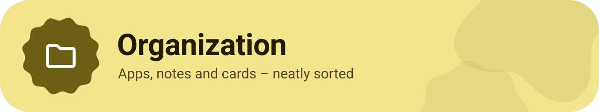

<table>
<tr>
<td width="50%"><b>App drawer</b><br>Favorites and recently used apps above the full A–Z list.</td>
<td width="50%"><b>Folders</b><br>Group apps your way – an app can be in several places.</td>
</tr>
<tr>
<td><b>Notes</b><br>Checklists, lists, headings and more – saved as you type.</td>
<td><b>Pinned cards</b><br>Keep important information on your home screen.</td>
</tr>
<tr>
<td><b>Hidden events</b><br>Swipe events away and restore them anytime.</td>
<td><b>Search history</b><br>Optional – cleared with one tap.</td>
</tr>
</table>

<!-- MEDIA · Organization. Uncomment and add your files:
<p align="center">
  &nbsp;
  
</p>
-->

<br>

<a name="ai"></a>


<table>
<tr>
<td width="50%"><b>8 providers</b><br>Gemini, Groq, OpenRouter, Mistral, OpenAI, Anthropic, Perplexity, DeepSeek.</td>
<td width="50%"><b>Web search</b><br>Answers with sources, grounded in the web.</td>
</tr>
<tr>
<td><b>Images</b><br>Attach photos from your gallery or camera.</td>
<td><b>Your data, your call</b><br>Local data only when you allow it – one by one.</td>
</tr>
<tr>
<td><b>Actions</b><br>Events, alarms, timers, messages, routes – run only when you tap.</td>
<td><b>Continue anywhere</b><br>Hand the conversation over to your favorite AI app.</td>
</tr>
</table>

<!-- MEDIA · AI. Uncomment and add your file:
<p align="center"></p>
-->

<br>

<a name="design"></a>

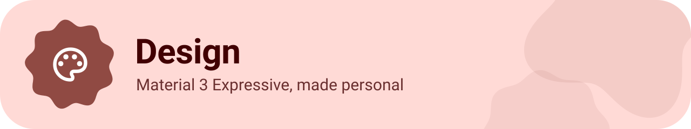

<table>
<tr>
<td width="50%"><b>Your colors</b><br>Material You or nine color themes – or pick your own.</td>
<td width="50%"><b>Light, dark &amp; AMOLED</b><br>Automatic or fixed – with true black.</td>
</tr>
<tr>
<td><b>Wallpaper &amp; blur</b><br>Your wallpaper behind the cards, adjustable brightness and blur.</td>
<td><b>Expressive motion</b><br>Stacked cards, shape morphing and smooth transitions.</td>
</tr>
<tr>
<td colspan="2"><b>Details that matter</b><br>Rounded outline icons everywhere, original service logos and weather icons in the app's style.</td>
</tr>
</table>

<!-- MEDIA · Design. Uncomment and add your files:
<p align="center">
  &nbsp;
  &nbsp;
  
</p>
-->

<br>

<a name="privacy"></a>

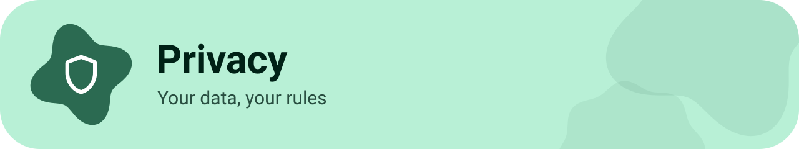

<table>
<tr>
<td width="50%"><b>Free providers only</b><br>One switch turns off Google and other proprietary services.</td>
<td width="50%"><b>Permissions on your terms</b><br>Every permission explained – internet and app search can be switched off.</td>
</tr>
<tr>
<td><b>No ads</b><br>Result cards are ad-free.</td>
<td><b>Keys stay safe</b><br>Encrypted in the Android Keystore, never part of backups.</td>
</tr>
<tr>
<td colspan="2"><b>Stays on your device</b><br>Notification history and recently played music are never backed up.</td>
</tr>
</table>

<br>

<a name="works-with"></a>


<p align="center"><b>Search engines</b></p>
<p align="center">
  
  
  
  
  
  
  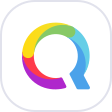
  
</p>

<p align="center"><b>AI providers</b></p>
<p align="center">
  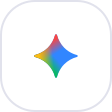
  
  
  
  
  
  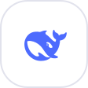
  
</p>

<p align="center"><b>Music &amp; song recognition</b></p>
<p align="center">
  
  
  
  
  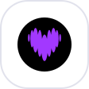
  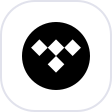
  
  
  
  
  
</p>

<p align="center"><b>Movies &amp; series</b></p>
<p align="center">
  
  
  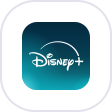
  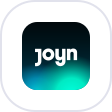
  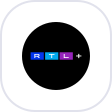
  
  
</p>

<p align="center"><b>Knowledge, weather, maps &amp; more</b></p>
<p align="center">
  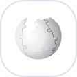
  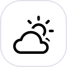
  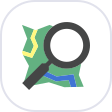
  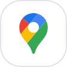
  
</p>

<p align="center"><sub>All trademarks and logos belong to their respective owners.</sub></p>

<br>

<a name="get-started"></a>

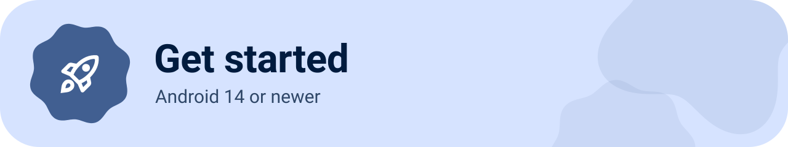

<table>
<tr>
<td width="50%"><b>Requirements</b><br>Android 14 or newer.</td>
<td width="50%">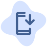<b>Install</b><br>Download the latest APK from <b>Releases</b> and open it.</td>
</tr>
</table>

<!-- Build from source:
```
./gradlew :app:assembleRelease
```
-->

<br>

## 📄 License

Universal Search is licensed under the **Apache License 2.0**.<br>
The font <i>Google Sans Flex</i> is licensed under the **SIL Open Font License**.

<br>

<div align="center">
  <sub>Made with ❤️ for people who want their phone their way.</sub>
</div>
